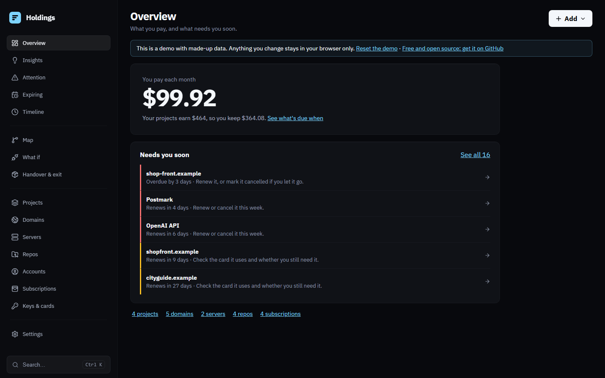
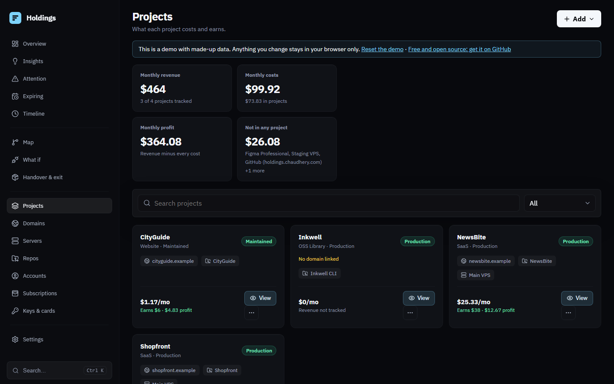
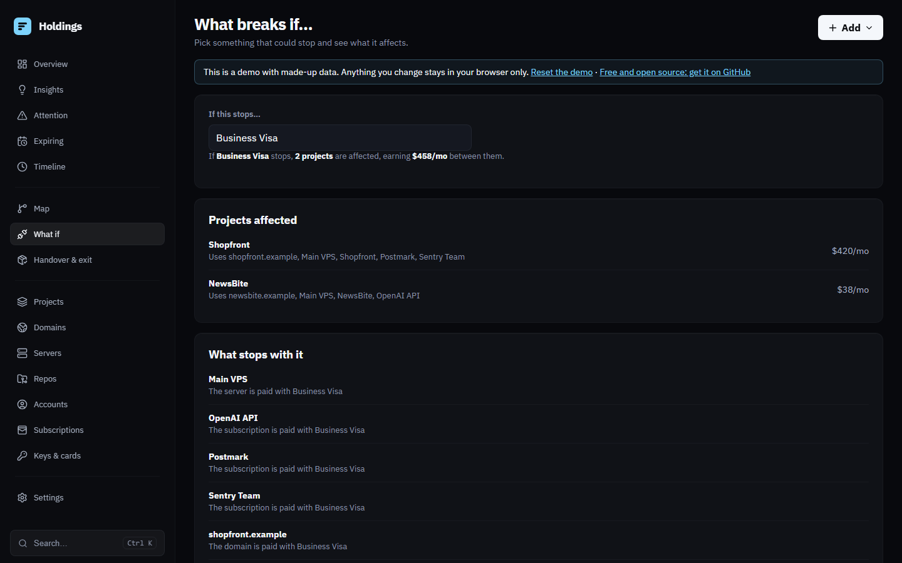
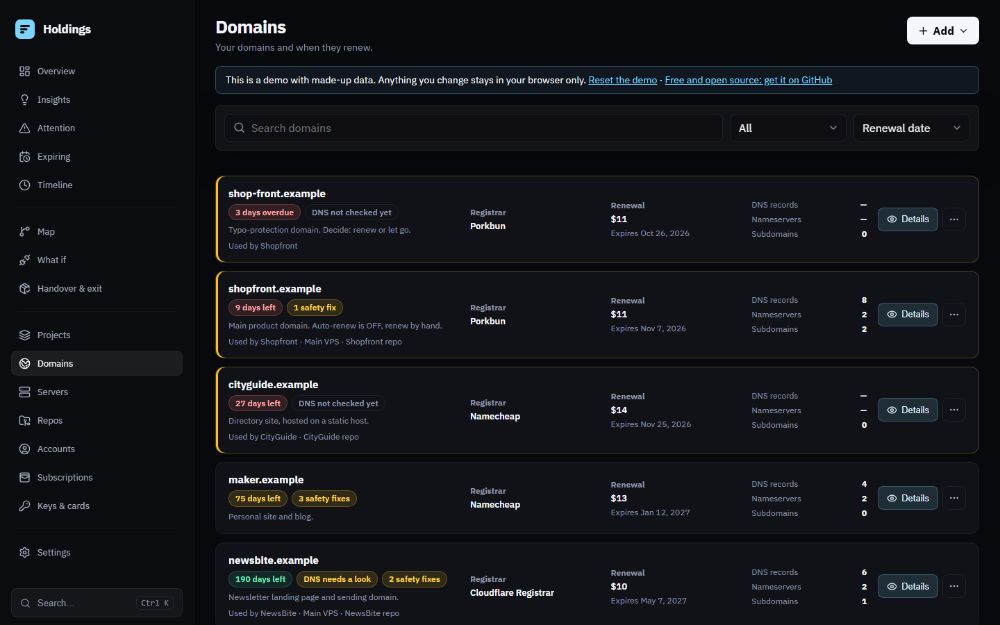
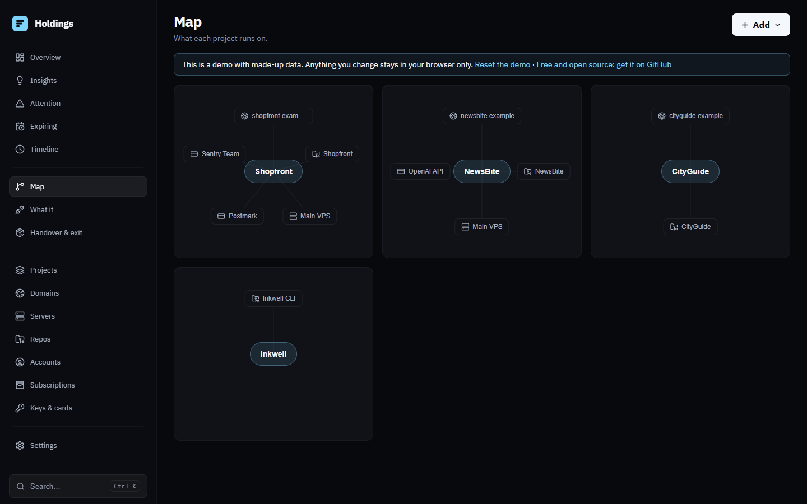

# Holdings

**Everything your side projects run on, in one place.** Domains, servers, repos, accounts, subscriptions, keys and cards, grouped by project, with what each project costs and earns, what's about to expire, and what breaks if something stops.

[](https://github.com/chmuzamil/holdings/actions/workflows/ci.yml)
[](LICENSE)
[](https://github.com/chmuzamil/holdings/releases/latest)
[](https://holdings.chaudhery.com)

**[Try the live demo →](https://holdings.chaudhery.com)** It uses made-up data, and anything you change stays in your browser.

[](https://holdings.chaudhery.com)

If you run a handful of side projects, you probably have 20 domains at three registrars, a couple of VPSes, a pile of SaaS subscriptions and a dozen repos. They're spread across a spreadsheet, your inbox and your memory. Holdings puts them in one register, links each one to the project it belongs to, and tells you what that project costs per month and what renews next.

It runs entirely in your browser. No account, no tracking, no server required. If you want it on every device, run it on your own server with one Docker command and a login.

> **Status:** v0.2, with v0.3 under way. The asset register, "what breaks if…", the expiry radar, handover and exit packs, self-hosting with a login, Stripe revenue and an MCP server for AI agents all work today. Still young: feedback and issues are very welcome.

## Who it's for

Solo founders and indie hackers with **several projects**, who want to answer questions like:

- What does each project cost me per month?
- What renews or expires in the next 30 days, and which project is it for?
- Which subscriptions aren't attached to anything any more?
- Which server does this domain point to, and which repo deploys there?

If you want a homelab start page, [Homepage](https://github.com/gethomepage/homepage) or [Homarr](https://github.com/homarr-labs/homarr) are better fits. If you want uptime monitoring, use [Uptime Kuma](https://github.com/louislam/uptime-kuma) or [Gatus](https://github.com/TwiN/gatus).

## What works today

- **Projects as the centre.** Link domains, servers, repos and subscriptions to a project and see what it costs and earns each month. A server shared by two projects is split between them, and anything not in a project is shown separately, so the numbers always add up.
- **"What breaks if…"**: pick a server, domain, service or payment card and see which projects it affects, how much revenue they earn, and what else stops with it (including subdomains that point at it).
- **Keys & cards, and an expiry radar**: track API keys, tokens, OAuth apps, TLS certificates and cards by name, where they are kept and when they expire or need rotating. Never the secret itself: Holdings refuses to save anything that looks like a real key or card number. Mark which card pays for what, and see everything that renews or expires on one page, soonest first.
- **Domains** with subdomains attached to servers, notes, renewal dates, and an optional live DNS + registry (RDAP) check. **Safety checks** then show what to fix and how: transfer lock, registration ending, nameservers, SPF, DMARC and DNSSEC.
- **Servers, repos, accounts and subscriptions** with costs, renewal dates and notes.
- **GitHub import**: fetch your repos by username. An optional token is kept in memory only, never saved.
- **Clean-up suggestions** on the Insights page: paid items no project uses, items only archived projects use, duplicate subscriptions, with what you could save.
- **Attention list**: what is overdue or due soon, and what to tidy up, each with the next step to take.
- **Timeline** built only from real dates: when you added things, when repos were created, when domains were registered.
- **Costs in USD**, with an optional second display currency. Its rate is fetched daily from [ExchangeRate-API](https://www.exchangerate-api.com).
- **Handover and exit packs**: a locked "if I'm unavailable" file for someone you trust (opens offline in any browser with a passphrase, never contains passwords or keys), and an asset register with a transfer checklist for selling a project.
- **Self-hosting** (optional): one Docker container with a password and two-step login, your data saved on your server and available in every browser.
- **Revenue from Stripe** (self-hosted): link Stripe products to a project and its monthly revenue fills itself in, with a read-only key.
- **MCP server** so Claude, Cursor and other agents can answer questions about your portfolio, read-only.
- **Command palette** (Ctrl/Cmd + K) to jump to anything.
- **Export and import** everything as JSON.
- **Demo mode** with a made-up portfolio, to look around before adding your own data.

| Projects | What breaks if… |
| --- | --- |
|  |  |
| **Domains** | **Map** |
|  |  |

## Quick start

The fastest way to look around is the **[live demo](https://holdings.chaudhery.com)**. To run it yourself, you need Node.js 22.13 or newer.

```bash
git clone https://github.com/chmuzamil/holdings.git
cd holdings
npm ci
npm run dev
```

Open http://localhost:5173. On first run you can add a project, load the demo data, or import a JSON export.

To use the live DNS/registry check, run the small lookup server in a second terminal. The dev server forwards `/api` to it.

```bash
npm run api
```

### Self-hosting with Docker

Run it on your own server, with a login, so your data follows you between browsers:

```bash
git clone https://github.com/chmuzamil/holdings.git
cd holdings
docker compose up -d
docker compose logs holdings   # shows a one-time setup code
```

Open http://localhost:8080, enter the setup code and pick a password. You can add two-step login with an authenticator app in Settings. Everything lives in one SQLite file in a Docker volume. [docs/self-hosting.md](docs/self-hosting.md) covers HTTPS, settings, backups and what to do if you're locked out.

### Ask an AI agent

`npm run build:mcp` builds a small read-only MCP server. Point it at a JSON export and Claude, Cursor or any MCP client can answer questions about your portfolio: what renews soon, which project loses money, what breaks if a server dies. Setup for each client is in [docs/mcp.md](docs/mcp.md).

### Hosting it as static files

`npm run build` produces static files in `dist/` that any web server can serve. `npm run build:demo` builds the public demo version, and `scripts/deploy-demo.sh <ssh-host>` builds and publishes it to a server over SSH. [docs/hosting-the-demo.md](docs/hosting-the-demo.md) has ready-to-use Caddy and nginx configs with a tested Content-Security-Policy.

## Your data and privacy

- Everything is stored in your browser's local storage. Nothing is sent to a server you don't run.
- With the self-hosted server, it is also saved in a SQLite file on your server. Passwords are hashed with scrypt, and the two-step login secret is encrypted.
- Clearing site data deletes it, so use **Settings → Export JSON** for backups.
- The app only contacts other services when you ask it to:
  - `api.github.com`, when you fetch or refresh GitHub repos
  - `open.er-api.com`, once a day, if you picked a second currency or Stripe reports revenue in a currency other than USD
  - `api.stripe.com`, from your server only, if you connect Stripe (read-only key)
  - your own server (or `npm run api`), when you run a DNS check. It queries DNS, IANA's registry directory and the domain's public registry (RDAP).
- No analytics, no telemetry, no third-party scripts, fonts or icons.

## Why not…

| | Holdings | Wallos | Domain Locker | Uptime Kuma | Homepage | Coolify |
| --- | :---: | :---: | :---: | :---: | :---: | :---: |
| Domains, servers, repos, subscriptions in one place | ✅ | subscriptions | domains | – | links | apps it deploys |
| Grouped by project, with cost per project | ✅ | – | – | – | – | – |
| Renewal and expiry tracking | ✅ | ✅ | ✅ | domain expiry | – | – |
| Live DNS / registry check | ✅ | – | ✅ | – | – | – |
| Uptime monitoring | – | – | – | ✅ | status widgets | app health checks |
| Revenue per project | ✅ (typed in; Stripe etc. planned) | – | – | – | – | – |
| "What breaks if…" impact view | ✅ | – | – | – | – | – |
| Handover and sale (due-diligence) packs | ✅ | – | – | – | – | – |
| API key, certificate and card expiry (metadata only) | ✅ | – | SSL | certs | – | – |
| Built-in MCP server for AI agents | ✅ read-only | community | – | community | – | own apps only |
| Works with no server at all | ✅ | – | – | – | – | – |

These tools are great at what they do, and Holdings doesn't try to replace them. Keep Uptime Kuma for monitoring and Coolify for deploys. Holdings is the register of what you own and what it costs.

## Roadmap

**v0.2: the founder's asset register**
- ✅ **Project ledger**: monthly cost against revenue for each project, with shared servers split fairly. With the self-hosted server, revenue can come straight from Stripe (read-only). Lemon Squeezy and Paddle are next.
- ✅ **"What breaks if…"**: pick a domain, server, service or card and see what it affects and the revenue involved.
- ✅ **Expiry radar**: domains, TLS certificates, API keys, tokens, OAuth apps and payment cards in one list, soonest first. Metadata only: Holdings refuses to save anything that looks like a real key or card number.
- ✅ **Exit pack**: a one-click asset register and transfer checklist for selling a project (Markdown, JSON or print).
- ✅ **Handover pack**: a passphrase-locked file for someone you trust, readable offline in any browser (AES-256-GCM, PBKDF2 with 600,000 iterations).
- ✅ **MCP server** (read-only), so Claude, Cursor and other agents can answer questions like "what renews this month?" or "what breaks if this server dies?". It reads a JSON export, or live data from the self-hosted server with a read-only access token. See [docs/mcp.md](docs/mcp.md).
- ✅ **Self-hosted mode**: one Docker container (Node + SQLite) with a login (password plus optional two-step codes) and saving to your server. Scheduled checks and notifications come next.

**v0.3: it watches for you** (in progress)
- ✅ **Domain safety checks**: transfer lock, registration ending, nameservers, SPF, DMARC and DNSSEC, each with the next step.
- ✅ **Clean-up suggestions**: what you pay for that no project uses, what only archived projects use, duplicate subscriptions, and things marked cancelled that still renew, with the possible saving.
- **Uptime Kuma / Gatus status**: up or down next to each server and project, read from your own instance.
- ✅ **Notifications** (self-hosted, optional): renewals and expiries by email, webhook (Slack, Discord) or ntfy, each switched on separately.
- **Dead-man's switch**: if you don't check in for a while, the person you chose gets your locked handover file.

**v0.4: less typing**
- Read-only importers for Cloudflare, registrars with an API (Porkbun, Namecheap, Spaceship) and Hetzner / DigitalOcean servers.
- Lemon Squeezy and Paddle revenue, next to Stripe.
- CSV import for the spreadsheet you already keep.

**v0.5: sharing**
- A read-only second user: a co-founder, an accountant, or a buyer during a sale.
- Verified backups via [BackupProof](https://github.com/chmuzamil/BackupProof).
- A read-only data room link for the exit pack, with an expiry date.

**Not planned, on purpose**: storing real secrets (Holdings keeps names, dates and where things live, never the key itself); uptime monitoring (Uptime Kuma and Gatus do it well, so Holdings reads them); a hosted multi-user service.

## Development

```bash
npm run dev          # app with hot reload
npm run api          # DNS/registry lookup server on 127.0.0.1:4180
npm test             # unit tests (Vitest)
npm run lint         # ESLint
npm run build        # production build
npm run build:demo   # demo build with made-up data
npm run build:server # bundle the self-hosted server
npm run build:mcp    # bundle the read-only MCP server (docs/mcp.md)
npm run server       # run it (see docs/self-hosting.md)
```

CI runs lint, typecheck, tests and builds on Node 22 and 24 for every pull request, and builds and smoke-tests the Docker image.

Optional environment variables are listed in [.env.example](.env.example).

## Contributing

Issues and pull requests are welcome. See [CONTRIBUTING.md](CONTRIBUTING.md). The one hard rule: **only fictional data in the repo.** Use `.example` domains and documentation IP ranges, never real ones.

To report a security problem, see [SECURITY.md](SECURITY.md).

## License

[MIT](LICENSE)
